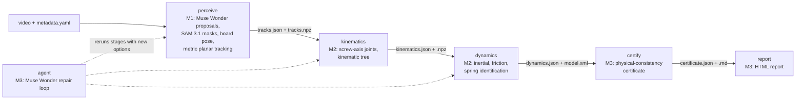

# Twinfit architecture

Frozen by the setup session on 2026-10-31. Milestones build against this document and
`src/twinfit/contracts/`; changes go through `docs/contract_change_requests/`.

## Pipeline



`twinfit run CLIP_DIR` executes the five stages through `twinfit.runner.pipeline.run_pipeline`.
The registry (`twinfit.runner.registry`) resolves each stage to its real implementation or to the
oracle stub in `twinfit.stubs.oracle`; `auto` uses the real module when it imports and the stub
otherwise.

## Conventions

- Units are SI: m, kg, s, rad, N, N·m. Reports may show degrees and mm; files never do.
- `T_A_B` is the 4×4 homogeneous pose of frame B expressed in frame A, so p_A = T_A_B p_B. Same for R_A_B and p_A_B.
- Rotations are stored as matrices. Quaternions appear only at the MuJoCo boundary, scalar-first (w, x, y, z).
- Camera frames follow OpenCV: x right, y down, z forward along the optical axis. MuJoCo cameras look along -z with y up. Convert with R_cv = R_mj · diag(1, -1, -1).
- The world frame W is the ChArUco board frame, exactly as defined by the coordinates from the installed OpenCV's `CharucoBoard.getChessboardCorners()`, with z = 0 on the printed face.
  - Determine empirically, and document, which printed direction is +x and which is +y, and whether +z points out of the printed face toward the viewer or into it.
  - Derive `up_W`: the unit vector pointing up when the board is mounted vertically with the printed UP arrow on top.
  - Derive `normal_toward_camera_W`: the unit normal pointing from the printed face toward the viewer.
  - Both are constants computed at import from the board definition, with a test.
- Gravity: `gravity_W = -9.81 · up_W` for `vertical_arrow_up`, and `gravity_W = -9.81 · normal_toward_camera_W` for `horizontal_face_up`.
- `plane_offset_m` is the signed distance from the printed face to the plane containing the moving parts' camera-facing surfaces. It is positive toward the camera, along `normal_toward_camera_W`.
- Part ids match `p[0-9]+` and joint ids match `j[0-9]+`. The id `"world"` is reserved for W treated as a fixed link, and never appears in tracks.
- A part frame P is any frame rigidly attached to the part. Consumers must not assume its origin or orientation.
- Time is in seconds from the first decoded frame, taken from container timestamps. Variable frame rate is tolerated.
- The joint coordinate q is 0 at the reference frame index. Revolute q follows the right-hand rule about `axis_W`; prismatic q is the displacement along `axis_W`.

Empirical board frame (installed OpenCV 5.0, `tests/setup/test_conventions.py`): with the UP arrow
on top, printed +x runs to the right and printed +y runs down the page, so +z points into the
printed face, away from the viewer. Hence `up_W = (0, -1, 0)`, `normal_toward_camera_W = (0, 0, -1)`,
`gravity_W = (0, 9.81, 0)` for `vertical_arrow_up` and `(0, 0, 9.81)` for `horizontal_face_up`. An
upright head-on view of the board has an OpenCV camera rotation R_W_C = I at a negative z.

Board constants: ChArUco DICT_5X5_100, 7 × 5 squares, square 0.035 m, marker 0.026 m (nominal).
Part markers DICT_4X4_50, ids 0 to 11, 0.030 m (nominal). Real clips override the lengths with
measured values in `metadata.yaml`.

Camera intrinsics of synthetic clips: fy = (H/2)/tan(fovy/2), fx = fy, and the principal point
at (W/2 - 0.5, H/2 - 0.5) in OpenCV pixel coordinates (pixel centres at integers). Zero distortion.

## Contracts

Every model has `model_config = ConfigDict(extra="forbid")`. Every top-level file model carries
`contract_version: "1.0"` and `extras: dict`. Arrays live in `.npz` files next to the JSON, and
`twinfit.contracts.io` validates on both read and write: shape and dtype (float64 or bool), finite
values on valid frames, rotation orthonormality |RᵀR - I| < 1e-6 with det(R) > 0, and homogeneous
last row [0, 0, 0, 1]. The npz writer fixes zip timestamps so identical arrays give identical bytes.

### ClipMetadata, `metadata.yaml` (every clip folder)

| Field | Type | Meaning |
|---|---|---|
| clip_id | str | folder name, for real clips `<mechanism>_<A or B>_<nn>` |
| source | real, synthetic | |
| mechanism | str | |
| video | relative path | the clip video |
| camera_id | str | one calibration per camera_id |
| intrinsics | relative path | `camera_intrinsics.json` |
| board | {type charuco, dictionary, squares_x, squares_y, square_length_m, marker_length_m} | measured lengths for real clips |
| board_orientation | vertical_arrow_up, horizontal_face_up | |
| motion_model | planar, spatial | |
| plane_offset_m | float | signed, positive toward the camera |
| gravity_W | 3 floats or null | null: derived from board_orientation |
| parts_hint | list of {label, fixed, mass_kg} | fixed and mass_kg may be null |
| part_markers | {dictionary, marker_length_m, assignments: label to id} or null | Take A only |
| free_motion_segments_s | list of [t0, t1] | |
| dynamics_gt | bool | |
| notes | str | |

### CameraIntrinsics, `camera_intrinsics.json`

camera_id, width, height, K (3×3), dist (k1, k2, p1, p2, k3), rms_reprojection_px or null,
n_frames_used or null, source (calibration, synthetic).

### PartTracks, `tracks.json` + `tracks.npz`

JSON: clip_id, source (perception, synthetic_gt, marker_gt), fps_nominal, n_frames, motion_model,
plane {point_W, normal_W} or null, gravity_W, camera {intrinsics, static, T_W_C (null when the
camera moves)}, parts [{part_id, label, is_base_hint, extent_P [[min], [max]] or null}],
free_motion_segments_s, free_motion_source (metadata, llm, none), arrays = "tracks.npz".

npz: `t` (N,) float64; `T_W_C` (N, 4, 4) only when the camera is not static; per part
`T_W_P__<part_id>` (N, 4, 4), `valid__<part_id>` (N,) bool, `quality__<part_id>` (N,) float64
(RMS fit residual in metres, NaN where invalid). Invalid frames may hold any finite pose;
consumers mask them out.

### KinematicModel, `kinematics.json` + `kinematics.npz`

JSON: clip_id, source (identify, synthetic_gt), base_part_id (part id or "world"),
reference_frame_index, links [{part_id, parent_joint_id or null}], joints, arrays.

Each joint: joint_id, parent_part_id, child_part_id, type (revolute, prismatic, fixed), axis_W
(unit, at the reference frame), point_W (revolute: the point on the axis closest to the W origin;
otherwise null), axis_parent and point_parent (the same in the parent part frame; for "world" they
equal the W values), q_range_observed [lo, hi], fit {rms_point_m, n_frames}, type_scores
{revolute, prismatic, fixed} (lower is better, method in extras), confidence in [0, 1].

npz: `t`, and per joint `q__<joint_id>`, `qd__<joint_id>`, `qdd__<joint_id>`, `valid__<joint_id>`.

### DynamicsModel, `dynamics.json` + `model.xml`

JSON: clip_id, source, mjcf = "model.xml", gravity_W, mass_scale_known, links [{part_id, mass_kg,
com_P, inertia_com_P (3×3 about the COM in P axes), prior_dominated}], joints [{joint_id, damping,
frictionloss, armature, stiffness, springref}], identifiability {rank, n_params, condition_number,
unidentifiable [{combination, reason}]}, fit {segments_s, replay_rms per joint, window_s, method}.

model.xml rules: loads with `mujoco.MjModel.from_xml_path`; the worldbody frame equals W; body
names equal part ids and joint names equal joint ids; the base part is a body welded to the world
(no joint) unless the base is "world"; geoms are visualization only (contype=0, conaffinity=0);
`<option gravity>` equals gravity_W; inertial properties are explicit (`<inertial fullinertia>`).
Set `<compiler angle="radian"/>`: MuJoCo parses `springref` in degrees otherwise. `load_dynamics`
checks these rules. The synthetic ground truth lists every body (including the welded base) in
`links`; a welded base may also be left out of `links`.

### Certificate, `certificate.json` + `certificate.md`

clip_id, verdict (VERIFIED, VERIFIED_WITH_CAVEATS, REJECTED, NOT_RUN), checks [{check_id, title,
subject, status (pass, warn, fail, not_applicable, not_run), value, threshold, unit, evidence}],
caveats, generated_by. `compute_verdict(checks, caveats)`: any fail gives REJECTED; otherwise any
warn or caveat gives VERIFIED_WITH_CAVEATS; otherwise at least one pass gives VERIFIED; otherwise
NOT_RUN. Milestone 3 must use this function.

## Stage interface (`contracts/stage.py`)

`StageName` is perceive, kinematics, dynamics, certify or report, with folders `01_perceive`,
`02_kinematics`, `03_dynamics`, `04_certify`, `05_report`.

`StageContext` (frozen dataclass): clip_dir, run_dir, stage_dir, metadata, upstream (stage name
to StageResult), cost_tag. `ctx.upstream_path(stage, key)` gives an upstream output path.

`StageResult`: stage, status (ok, failed, skipped), impl (real, stub), outputs (key to path
relative to run_dir), metrics, messages, cost_usd, duration_s.

| Stage | Required output keys | Optional keys |
|---|---|---|
| perceive | tracks_json, tracks_npz | masks_dir, overlay_mp4, perception_report |
| kinematics | kinematics_json, kinematics_npz | |
| dynamics | dynamics_json, model_xml | |
| certify | certificate_json, certificate_md | |
| report | report_html | |

Options (all fields optional with defaults, extra="forbid"): `PerceptionOptions` (part_prompts,
box_prompts [{label, frame_index, box_xyxy_px}], frame_stride, max_frames, exclude_labels,
use_part_markers, llm_part_proposal, oracle_noise {trans_m, rot_rad, seed}), `KinematicsOptions`
(force_joint_types {"parent->child": type}, force_base_part, exclude_time_ranges_s,
planar_constraint), `DynamicsOptions` (segments_s, fit_stiffness, fit_coulomb, fix_params, mass_kg,
window_s), `CertifyOptions` (thresholds_override), `RunOptions` (perceive, kinematics, dynamics,
certify). The report stage receives `None`.

Every stage exposes `run(ctx: StageContext, options) -> StageResult` and writes only inside
`ctx.stage_dir`. Real implementations never read `ctx.clip_dir / "gt"`. The runner turns an
exception into a failed result and marks later stages skipped.

Shared replay: `twinfit.sim.replay.simulate` (RK4, 2e-4 s, exact landing on output times) and
`windowed_replay_rms` (windows of `window_s` tiling each free-motion segment, restarted from the
observed state; windows with invalid frames skipped). Milestones 2 and 3 both use them so fitting
and certification measure the same quantity.

## Layouts

Run folder `runs/<run_id>/` (run ids default to `<clip_id>__<UTC yyyymmddThhmmss>`):

```
run.json                 clip_dir, clip_id, impl per stage, git_commit, started, ended, total_cost_usd
01_perceive/             stage_result.json, tracks.json, tracks.npz, optional masks/, overlay.mp4
02_kinematics/           stage_result.json, kinematics.json, kinematics.npz
03_dynamics/             stage_result.json, dynamics.json, model.xml
04_certify/              stage_result.json, certificate.json, certificate.md
05_report/               stage_result.json, index.html and media
```

Clip folder (real or synthetic):

```
metadata.yaml  video.mp4 (or .mov)  camera_intrinsics.json (synthetic; real clips point to _calibration)
gt/                      synthetic only: camera_extrinsics.json {"T_W_C"}, tracks.json/.npz,
                         kinematics.json/.npz, dynamics.json + model.xml (dynamics scenes), masks/%06d.png
```

Data dir `~/twinfit-data` (override with `TWINFIT_DATA_DIR`), shared by all worktrees:

```
synth/synth_tiny/        6 clips, seed 0, 320x180, 30 fps, 2 s
synth/synth_small/       12 clips, seeds 0 and 1, 1280x720, 60 fps, 8 s
real/<clip_id>/          Ahaan's clips
real/_calibration/<camera_id>/   calib video and camera_intrinsics.json (written by M1)
real/_template/metadata.yaml
cache/meta/              content-addressed Meta API responses
printables/              charuco_board_letter.pdf, part_markers_letter.pdf, speckle_letter.pdf
cost_ledger.jsonl        append-only spend ledger (all worktrees)
```

Synthetic scenes (`twinfit.synth.scenes`): pendulum_1r, double_pendulum_2r, lamp_spring_2r,
slider_incline_1p, door_spring_1r_h (planar, dynamics ground truth) and arm_3r_spatial (spatial,
kinematics only). Ground truth masks use label = part index + 1. The seed-0 camera sits 0.9 m from
the scene at a 7.5 degree tilt (35 degrees for the spatial scene); other seeds randomise the pose.

## Ownership

| Owner | Paths |
|---|---|
| Setup (frozen) | pyproject.toml (except other owners' optional groups), cli.py, paths.py, session.py, contracts/, geometry/, sim/, synth/, stubs/, meta/, eval/, runner/, printables/, tests/setup/, CLAUDE.md, docs/ARCHITECTURE.md |
| Milestone 1 | src/twinfit/perception/, tests/perception/, docs/m1_perception.md, docs/ledger/m1.md, docs/media/m1_*, optional group `perception` |
| Milestone 2 | src/twinfit/identify/, tests/identify/, docs/m2_identification.md, docs/ledger/m2.md, docs/media/m2_*, optional group `identify` |
| Milestone 3 | src/twinfit/verify/, src/twinfit/agent/, src/twinfit/bench/, src/twinfit/report/, tests/verify/, tests/agent/, tests/bench/, tests/report/, docs/m3_verify_agent.md, docs/ledger/m3.md, docs/media/m3_*, optional groups `verify` and `agent` |
| Integration | README.md, scripts/, docs/ledger/integration.md, docs/DEMO_SCRIPT.md, docs/SUBMISSION.md, merges |
